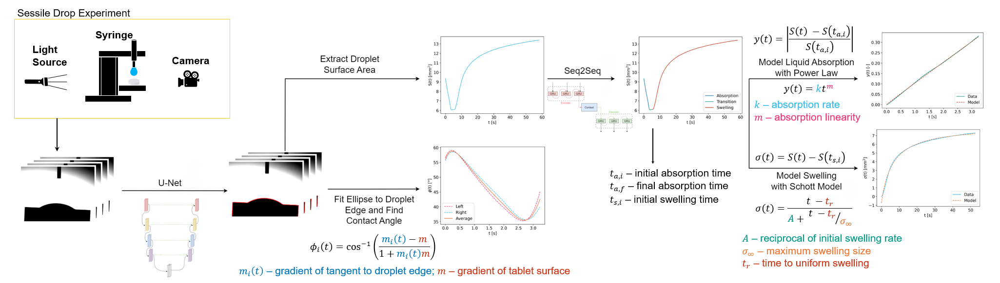

# An End-to-end Machine Learning Framework for the Characterisation of Tablet Disintegration
[](https://github.com/psf/black)

The following is the repository for the a data processing pipeline for the extraction, characterisation and modelling of
sessile drop experiments.
These experiments demonstrate the liquid absorption and swelling processes that
take place during tablet disintegration through the evolution of a water droplet
on the surface of a tablet.
Thus allowing for the study of such disintegration mechanisms.

An outline of the framework is shown below:


The frames of the experimental video are segmented using a trained
[UNet](https://arxiv.org/abs/1505.04597) model to identify the tablet/droplet
object in the frames.
The UNet identifies the tablet in the initial frame where no droplet is present
allowing us to subtract the tablet from the identified object in subsequent
frames.
The result is the evolution of the droplet in time.
The surface area of the droplet is then extracted from each frame along with the
contact angle which is found by fitting an ellipse to the surface of the
droplet.

The surface area curve is then analysed by a [sequence-to-sequence
(Seq2Seq)](https://arxiv.org/abs/1409.3215) model which identifies the regions
where absorption and swelling are each the dominant disintegration process
taking place.
This is achieved by having the encoder and decoder of the Seq2Seq models use
gated recurrent units (GRUs) to predict the class for the next surface area point based
on the information from previous points.

Then with the absorption and swelling data split, mechanistic models are fitted
to each with the absorption data fitted using a power law model and the swelling
data fitted using the [Schott model](https://doi.org/10.1002/jps.2600810516).

## Publication
The usage of this code was published in the International Journal of Pharmaceutics https://doi.org/10.1016/j.ijpharm.2026.127523.
This publication contains more information on how the models were trained and implemented.

## Usage

The code is designed to be used as a command line tool and as part of
interactive development environments (IDEs). The repository must first be
cloned:

```bash
git clone git@github.com:strath-cmac/sessile-drop.git
cd sessile-drop
```

To run the code in an IDE or in your own script, do the following:
```python
from sessile_drop import sessile_drop, sessile_drop_save
import tomli
from seq2seq import EncoderRNN, DecoderRNN
from unet import UNet

CONFIG = tomli.load(CONFIG_FILE_PATH)
device = CONFIG["device"]

enc = EncoderRNN(*CONFIG["enc_dims"]).to(device)
dec = DecoderRNN(*CONFIG["dec_dims"], device=device).to(device)
unet = UNet(*CONFIG["unet_dims"])

results = sessile_drop(
    "/path/to/video",
    device,
    CONFIG["needle_size"],
    CONFIG["batch_size"],
    unet,
    CONFIG["unet_path"],
    CONFIG["fps"],
    enc,
    dec,
    CONFIG["seq2seq_path"]
)

sessile_drop_save(results, "/path/to/video", CONFIG["save_masks"])#, CONFIG["save_dir"])
```

The resulting output will be an `.xlsx` file with sheets summarising the
relevant fitting parameters, the surface area from each frame, the contact angle
from each absorption frame, the absorption data post-transformation and the
swelling data post-transformation.
The output of the Python function will also be saved as a `.pkl` file containing
the surface area, contact angle and relevant parameters (and optionally the
segmentation masks if specified in the config file) which can be loaded into
other Python scripts.

### Config File Options

As stated above, the config files used for this framework use the TOML standard
with example an config file shown below:

```toml
device = "cuda:0" #device to run the analysis on
needle_size = 0.9 #the outer diameter of the needle used to dispense water
fps = 30 #frame per second of the video

batch_size = 32 #UNet batch size
unet_dims = [3, 64, 1] #UNet spec, [input channels, first hidden layer dim, number of classes]
unet_path = "unet.pth" #path to the UNet model

enc_dims = [1, 64, 2] #[input dimension, encoding dim, layer dim]
dec_dims = [1, 64, 2, 3] #dimensions for the encoder and decoder of the Seq2Seq model [input dimension, encoding dim, layer dim, number of classes, device]
seq2seq_path = "seq2seq.pth" #the path to the trained Seq2Seq model

save = true #whether or not to save the results
save_masks = false #whether or not to save the segmentation masks
# save_dir = "/save/dir" #the directory to save the results in, by default this
# is the same as the directory where the data is loaded from, to change this
# uncomment this line and provide a valid path
```

TOML uses key/value pairing which can be loaded into Python using the
[`tomli`](https://github.com/hukkin/tomli) library which will return the
contents of the TOML file as a dictionary.

In our case, the config file contains (up to) 12 settings:
| Setting        | Description                                                                                                                                                                      | Type       |
|----------------|----------------------------------------------------------------------------------------------------------------------------------------------------------------------------------|------------|
| `device`       | The hardware device to perform the computations on. This can be a GPU or CPU. If an `int` is given the code will run on a GPU device with CUDA ID equal to the provided number.  | str or int |
| `needle_size`  | The outer diameter of the needle used to dispense the water droplet is required to calculate the pixel size in physical units. This value is assumed to be in millimetres.       | float      |
| `row_idx`  | This is the row used to find the width of the needle to calculate the pixel size. | int      |
| `fps`          | How many frames per second (FPS) the video was captured at.                                                                                                                      | int        |
| `batch_size`   | The batch size to use for the image segmentation.                                                                                                                                | int        |
| `unet_dims`    | The number of input channels, dimension of first hidden layer and output channels for the UNet. This only needs changed if using a different architecture to the trained models. | list[int]  |
| `unet_path`    | The path to the trained UNet model for image segmentation.                                                                                                                       | str        |
| `enc_dims`     | The input dimension, hidden layer dimension and number of layers to use in the encoding part of the Seq2Seq model.                                                               | list[int]  |
| `dec_dims`     | The input dimension, hidden layer dimension, number of layers and number of classes to use in the decoding part of the Seq2Seq model.                                            | list[int]  |
| `seq2seq_path` | The path to the trained Seq2Seq model.                                                                                                                                           | str        |
| `save`         | Whether or not to save the results from the framework.                                                                                                                           | bool       |
| `save_masks`   | When saving the results from the framework, whether or not to save the segmentation masks that are the outputs from the UNet.                                                    | bool       |
| `save_dir`     | The directory to save the results from the framework in. This setting is optional, to use the line must be uncommented in the config file.                                       | str        |
